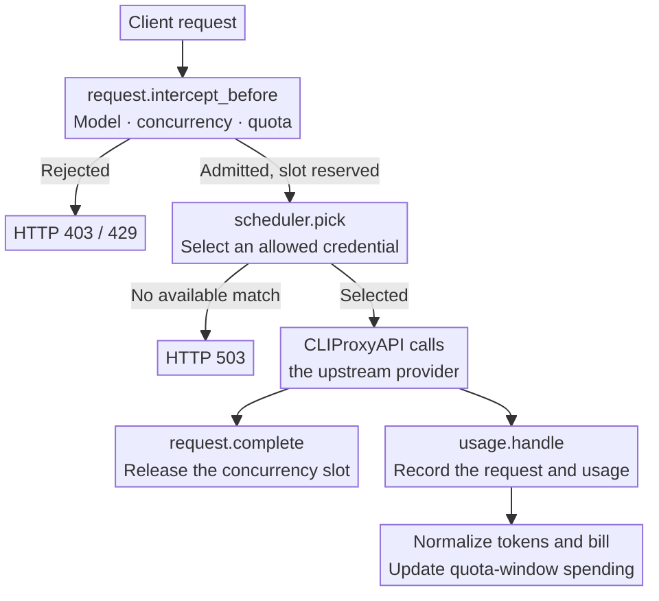
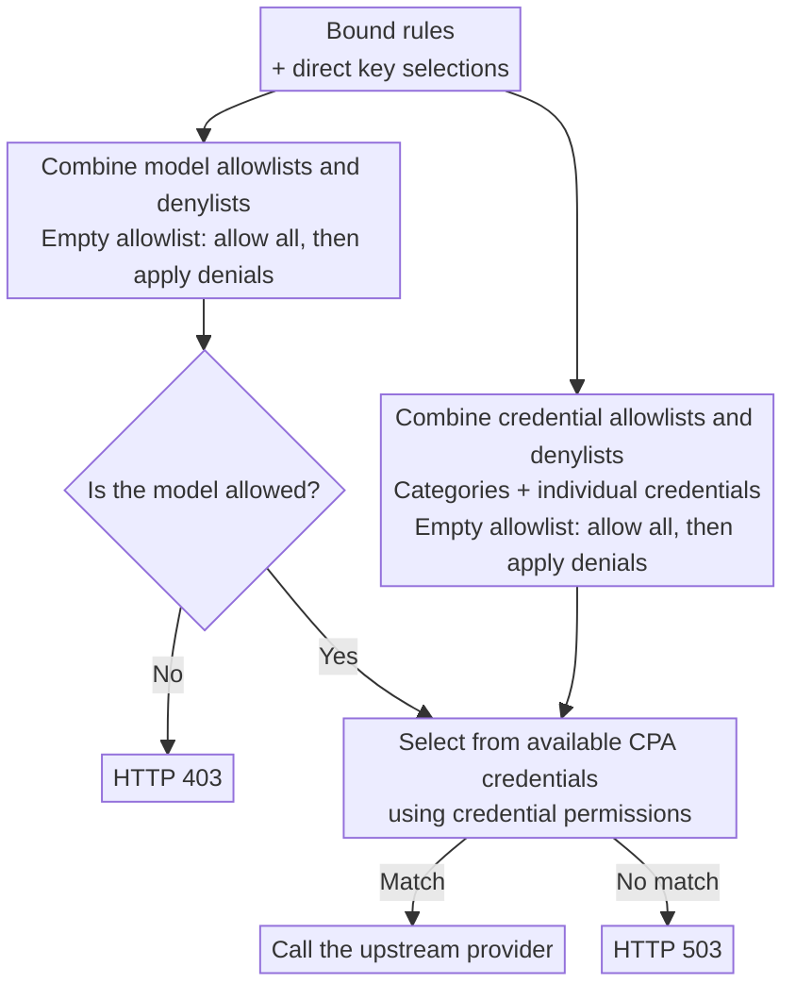

<div align="center">
  <h1>CPA Super Billing</h1>
  <p><strong>A <a href="https://github.com/router-for-me/CLIProxyAPI">CLIProxyAPI</a> plugin that splits Claude and ChatGPT (Codex) subscription quotas between downstream API keys.</strong></p>
  <p>
    <a href="https://github.com/sketchain/cpa-super-billing/releases/latest"></a>
    
    <a href="./LICENSE"></a>
  </p>
  <p><strong>English</strong> · <a href="./README.md">简体中文</a></p>
</div>

A fork of [cpa-key-billing](https://github.com/haowang02/cpa-plugin-key-billing). All of its billing, quota, concurrency and routing features remain; this fork adds the subscription split for Claude and ChatGPT Team (through CPA's Codex channel) accounts.


## Features

- **Subscription split**: fixed keys get a fixed weekly amount (for example $100 a week), while remainder keys may only use what the account has left after reserving the fixed keys' unused amounts (weekly and 5-hour reservations).
- Estimates each Claude account's total in USD only from passively observed utilization headers, never polling upstream, and filters out usage of the account outside CPA.
- A consumption forecast, a fixed key simulation and per-key usage charts, to judge whether a pool can take another key.
- A balance endpoint for new-api Advanced Custom channels.
- Bulk import of custom prices from a JSON price list.

- Set spending, token, and request quotas for each API key, with independent or shared reset schedules.
- Price models and subscription plans in USD or CNY, and view usage statistics in either currency.
- Shared quota plans let all bound keys consume one quota pool that resets on the plan's schedule.
- Apply separate rates to requests that exceed a long-context input threshold.
- Limit concurrent requests per API key.
- Control access to models and upstream credentials with routing rules.
- Use model reference prices from [models.dev](https://models.dev/), with optional custom overrides.

## How it works

Before a request reaches an upstream provider, the plugin checks subscription quotas, concurrency, and routing. After execution, CLIProxyAPI supplies usage through `usage.handle`. The plugin uses that record to store the request event, calculate its cost, and update spending for the current quota window.



## Subscription split

The **Subscription split** page has a Claude and a ChatGPT tab; each shows that provider's accounts, pools, key assignments, forecast, trend, simulation and model weights. The management routes stay under `/cc/...`.

### Concepts

- **Account**: one Claude or ChatGPT (Codex) OAuth credential in CPA (by `auth_index`), estimated on its own.
- **Pool**: a set of accounts of one provider (saving checks it) that fixed and remainder keys share; its remaining capacity is the sum of its accounts'. An anchor account, chosen with **Set as anchor** on the page, anchors the pool's weekly cycles and 5-hour window (pools saved before take their first account). An account can belong to only one pool; saving checks it.
- **Fixed key**: bound, on the API Key page, to a subscription plan with a **7-day amount window**; that amount is its weekly quota. **Give each fixed key a plan of its own**: aligning cycles changes the plan itself, which affects every key bound to it. Fixed keys cannot use a **shared quota** plan: every key of such a plan sees the whole pool's quota and usage, so per-key reservations would count the pool repeatedly. Saving the split settings, binding a fixed key to a shared plan, and switching a fixed key's plan to a shared quota are all refused.
- **Remainder key**: may only use what the pool has left after the fixed keys' reservations, optionally under its own weekly cap.

### ChatGPT (Codex) accounts

ChatGPT Team accounts, used through CPA's Codex channel, are split like Claude accounts (fixed and remainder keys, weekly and 5-hour reservations, the balance endpoint), with these differences:

- **Signals**: the `Used-Percent`, `Window-Minutes` and `Reset-At` of the `X-Codex-Primary-*` (5-hour, 300 minutes) and `X-Codex-Secondary-*` (7-day, 10080 minutes) response headers; for WebSocket requests CPA turns `codex.rate_limits` events into the same headers. Percentages may have decimals: a segment ends where the utilization crosses a whole point, and a rise across several points is one segment.
- **Segment window per account**: an account whose reports have a 5-hour window is segmented on it and k converts its total to the weekly one. An account with only the 7-day window is segmented on that window, so 1% is 1% of the weekly total, no k is needed, and it has no 5-hour reservation (marked **7-day window only**). If a 5-hour window appears later, its segments restart on it.
- **Tier and k**: one tier, Team, with a $60 weekly default and **no default k**. A manual k comes first, then the estimated one; without either the plugin does not guess: the 5-hour reservation is off, the weekly reservation still applies (on the tier default or the estimated weekly total), and the page asks for a k. An account whose `X-Codex-Plan-Type` is `team` gets Team suggested.
- **Main limit only**: a request's cost counts toward segments only when its own report carries a main window. Requests reporting only an additional pool (such as Spark), code review or image windows, or whose `X-Codex-Active-Limit` is not premium, and requests without a report do not count; the page totals them under **Cost left out of the estimates**.
- **Used up and credits**: while a report shows a window used up (`X-Codex-Limit-Reached`, or 100%) or the credit balance falling, the account's segments pause (its last estimate stays, marked **Paused**) and resume afterwards; no segment includes that period's cost.
- **Unpriced models**: with `allow_unpriced_models`, unpriced requests are recorded at $0; they stay out of segments and the page lists their models with a link to pricing.
- **Routing hint**: a key whose routing rules do not keep it on its pool's provider is flagged **Routing not limited** in the keys table; nothing is refused.

The parameters section edits each provider's tiers (weekly total and default k) and can override the block gap, sliding window width, k's minimum 7-day gain, cold start blocks and safety factor per provider (empty keeps the global value). Model quota weights are per provider too.

### Estimation

Anthropic reports `anthropic-ratelimit-unified-5h-utilization` and `7d-utilization` in whole percent only. Per account:

1. **1% segments**: every rise of the 5-hour utilization closes a segment whose cost is the plugin-priced cost of the account's requests during that point. Reports count at request start and costs at completion; out-of-order reports are absorbed because utilization never falls within a period, with the upstream 10-minute reorder horizon. Cost before a block's first rise is discarded.
2. **Blocks**: segments whose data points are at most 5 minutes apart; a 5-hour reset always breaks a block.
3. **Contamination filtering**: 8-point windows slide segment by segment; a window whose ratio (points per USD) exceeds the reference by 20% is suspicious, and a segment is excluded when at least 50% of the windows covering it are suspicious. The reference is the global weighted average, or the block's own iterative average while there is no history. Outside usage only raises ratios, so filtering only errs conservatively. Blocks narrower than one window are judged as a whole against the global reference.
4. **Global average**: clean block ratios weighted by `(clean gain)^p`; blocks of the last 14 days weigh 90%, older ones 10%. `T_5h = 100 / ratio`.
5. **k = weekly / 5-hour total**: paired 5-hour and 7-day gains between consecutive reports in which neither window reset, stored in hourly buckets with the segment retention. Like the totals, k is time-weighted: the last 14 days and older evidence each give `k = Σ5h / Σ7d`, valid once that group's 7-day gain reaches 10 points; two valid groups combine 90% / 10%, one valid group is used alone, otherwise the combined ratio counts if the total is enough, and without that there is no k. A manual value overrides it. `T_week = k × T_5h`.
6. **Cold start**: with fewer than 20 clean blocks, the tier's default weekly total applies (Pro $250, Max 5x $1250, Max 20x $2500). CPA's Claude credential files carry no tier, so choose it per account on the page (unset counts as Pro). In cold start `T_5h = default / k`. Without a manual k and before k is estimated, the tier's default k applies (8 for Pro, Max 5x and Max 20x, adjustable among the parameters); its source reads "tier default" and 5-hour reservations stay on.

On synthetic data (whole-percent reports, concurrency, sporadic and sustained outside usage, 5-hour resets) the 5-hour total is within about +0.3% on clean data and about −3% (conservative) under sustained outside usage; k is within 1%.

### Admission

- Per account: `R_week = s × T_week × (1 − u_7d)` and `R_5h = s × T_5h × (1 − u_5h)`, with safety factor `s` (0.9).
- Per pool: `P_week = Σ fixed max(0, weekly − used this cycle)`; each fixed key reserves `max(0, min(weekly / k − used this 5h window, weekly remaining))` for 5 hours (the `1/k` share can be overridden per key).
- A remainder key is admitted only when `Σ R_week > P_week` and, when 5-hour reservations are on, `Σ R_5h > Σ 5-hour reservations`. Refusals use the plugin's usual `429 rate_limit_error`; the message names the weekly reservation, the 5-hour reservation or the key's own weekly cap, and `Retry-After` points at that window's reset.
- Each refusal is logged once per key, reason and window reset, with the key, the reason (`weekly_reserve`, `five_hour_reserve`, `weekly_cap`, `pool_unavailable` or `not_loaded`) and the estimate that decided it.
- Fixed keys are only limited by their plan.
- Admission only reads an in-memory snapshot: keys outside every pool are admitted without touching the estimator; pooled keys combine the snapshot's totals with live utilization and live costs from usage callbacks, with no database query and no wait for a refresh. Refreshes run synchronously at startup, from usage callbacks (after the request, at most once a minute, skipped while one runs) and from the page's buttons; the plugin starts no background thread. When the settings are loaded but no estimate snapshot exists yet, remainder keys get 429 with reason `not_loaded` while fixed keys and keys outside every pool are admitted; the **Refuse remainder keys while estimates are not loaded** parameter (on by default) turns this off, and the subscription split page shows that the estimates are not loaded. Until even the settings load, every request is admitted (logged once). The balance endpoint returns 503 until the estimates load. Fixed keys' alignment results are cached; when the cache does not hold (first request, plan change, wait over), admission writes the plan's new anchor once.

### Fixed key cycles

The plugin switches the 7-day window of a fixed key's plan to a shared cycle anchored on the anchor account's 7-day `reset_at` (a rolling plan with other windows cannot be aligned; the page says so). After an early reset, detected as upstream `QuotaWindowPeriods` does, the current cycle keeps its usage and runs to its scheduled end; the next cycle ends at the account's new reset. Unused amounts expire and never pass to remainder keys. 5-hour reservations follow the anchor account's 5-hour window.

### Settings

Everything is set on the **Subscription split** page and stored in the database: segment retention (365 days, independent of request events), block gap (5 minutes), window width (8%), reference (global), suspicious threshold (20%), exclusion vote (50%), weight exponent p (2), recent period and share (14 days, 90%), weekly gain for k (10 points), cold start blocks (20), tier defaults ($250 / $1250 / $2500), tier default k (8 each), refusing remainder keys while estimates are not loaded (on), safety factor (90%), each account's tier and manual k, each pool's accounts and anchor, and each key's type, pool, 5-hour share override or weekly cap. Fixed keys that share a plan must be in the same pool.

### Quota trend

The subscription split page draws two daily charts for each pooled account, splitting days in the browser's time zone:

- Daily k: the day's k = its summed 5-hour gain / summed weekly gain (no k on a day without weekly gain), the rolling 7-day k (fewer days at the start), and a reference line for the effective k labelled auto, manual or tier default. Days whose weekly gain is below **k needs 7-day gain** (`k_min_weekly_points`) show as hollow points: their k is imprecise.
- Daily gains and projected weekly total: bars of the day's 5-hour and weekly gains, with the projected weekly total = k × $/1% × 100 on the right axis. $/1% is the cost over the gain of the day's segments, using only the segments the estimate kept; while the estimates are not loaded, no exclusion result exists and every stored segment counts. When the day's k is missing or imprecise the rolling k is used (diamond points).

Hovering shows the day's two gains, segments, cost, daily k, rolling k, $/1% and projected weekly total; the range switches between 7, 14 and 30 days and the whole retention. The charts read the stored hourly k evidence and 1% segments only: opening them never refreshes the estimates or writes to the database, and API key users do not see them.

### Model quota weights

Some models may use more subscription quota per USD than their API price suggests. On the subscription split page, mark such models as **test items** (several names of one model can form one item); every other model is baseline with a weight of 1.

- **Per-model split**: every 1% segment also records its cost by billing model. Segments recorded before the upgrade have no split and count as baseline; **Rebuild from history** recreates every segment with its split from the retained request records (segments older than the request retention cannot be split).
- **Historical estimate**: each segment's gain ≈ s × (baseline cost + Σ mᵢ × item i's cost), with an s per account and the multipliers mᵢ shared. Segments are cut into chunks of about 30 minutes, ending only at rises and by elapsed time rather than gain (cutting at a fixed gain moves the rounding error into the costs and biases the multipliers towards 1), and fitted by weighted least squares with the totals' time weighting (the last 14 days count 90%). The result gives each multiplier, its standard error and 95% interval, the segments used and the share range.
- **No filtering loop**: filtering judges $/1%, so on the raw basis segments heavy in a tested model look like outside usage. The multiplier estimate always filters on the converted basis, whatever the switch says: a robust fit of every segment that trims chunks far above the prediction gives the first multipliers, then filtering the converted costs and refitting the clean chunks alternate until they settle. A chunk with any excluded segment is dropped whole rather than cut there.
- **When no number is given**: too few clean segments or too little cost include the item (defaults 30 segments, $20): **not enough samples**; its share varies too little across chunks (standard deviation below 5% by default) or its variance inflation is too large: **share varies too little; calibrate**; a standard error above half the multiplier: **unstable estimate**.
- **Calibration**: choose an item and an account and press **Start calibration**, then **End calibration**. Segments of the period containing only the item give its $/1%, compared with baseline-only segments of the period (with fewer than 10, the account's recent baseline segments before it are added); segments mixing other models are excluded and counted. Once ended and processed, the result is stored and can be viewed or deleted.
- **Using the weights**: the switch **Use model multipliers in estimates** is off by default, and the estimate is then exactly as before. When on, every segment's cost is converted to the baseline basis (baseline cost + Σ mᵢ × Cᵢ) before filtering and weighting, so $/1% means baseline-model USD per 1%. Multipliers come from a manual override, then the latest calibration, then the historical estimate; an item with none counts as 1 and is marked. The page lists $/1%, weekly totals and excluded segments on both bases.
- **Pricing hint**: each item shows a suggested price multiplier (quota multiplier × current price multiplier, since segment costs are recorded at current prices) and its custom price over the official price. Display only; prices are never changed.

The multipliers are computed during refreshes into the snapshot; admission only reads the snapshot. `GET /cc/estimates` returns every account's estimate and the multipliers on the basis in effect.

### Consumption forecast

Below the account table, the subscription split page lists for each pool and account when the 5-hour and weekly usage will reach 100%, and when remainder keys will be refused by the weekly or 5-hour reservation (when the pool's remaining R minus the reservation P reaches 0).

- **Rate**: by default the last hour for the 5-hour window and the last 24 hours for the week, adjustable on the page (5–300 minutes / 1–168 hours, remembered in this browser only). The rise of the accounts' utilization readings comes first (a window that reset within the range starts from 0%, and only readings of the current window count); the pool keys' live spend converted with the estimated $/1% is shown beside it and used for accounts without readings.
- **Basis**: with **Use model multipliers in estimates** on, capacity is in baseline USD while key spend is billed at the price table, so the spend is converted with the effective multipliers first; a model whose price multiplier already equals its quota multiplier is not converted again. The tooltip names the basis used.
- **Remainder refusals**: R falls with the readings (or spend × the safety factor s) and P with the spend of fixed keys that still hold a reservation; the forecast is (R − P) ÷ (R's rate − P's rate).
- When the linear forecast lands after the window's reset, the cell reads **Not used up before reset**. Hovering a cell shows both rates, their time range and the method. Estimates are read from the manager's snapshot interface; opening the forecast never refreshes the estimates or writes to the database.

### Fixed key simulation

Choose a pool and add hypothetical fixed keys (weekly amount, optional 5-hour share, weekly usage defaulting to the whole amount), or change or remove existing fixed keys' amounts. The retained request history (at most 365 days) is replayed hour by hour:

- Each pooled key's hourly cost comes from the request records, converted to the quota basis when model multipliers are on. The pool's remaining capacity comes from each account's last utilization reading of the hour (so outside usage counts as it happened), moved by the use the scenario adds or removes; account totals and k are the current estimates.
- Cycles follow the anchor account's 7-day resets found in its reports (an early reset shortens a cycle); where none is known, they step back 7 days from the current reset.
- The result shows, per cycle, the hours remainder keys would be refused (weekly or 5-hour reservation), the spend not admitted (what remainder keys actually spent in those hours), the hours in which fixed keys' reservations exceeded the pool's remaining capacity (oversold), the largest shortfall and the oversold periods, side by side with an unchanged replay.
- It is approximate, and the page lists where: totals from the current estimates, outside usage taken from the readings, hourly steps, new keys spread over the pool's own hourly spend, an incomplete first cycle and so on. The simulation only reads: nothing is stored and no setting changes.

### Key usage

Each pool has a daily chart of its keys' cost (stacked bars at billed prices), with remainder keys' split refusals of the day as dashed lines on the right axis (the tooltip splits them by reason). Fixed keys also get a chart by plan cycle: what each cycle used and forfeited (weekly amount − used, settled when the cycle ends; a running cycle shows what is left, not forfeited). Days follow the browser's time zone, and the range switches between 7, 14 and 30 days and everything.

Refusals are counted by key, hour and reason in the `cc_block_counts` table (CC table format version 4). Admission runs on the request path, so it only adds to memory; the counts are written in one transaction by the next estimate refresh or when the usage charts are opened. Plugin log lines stay deduplicated as before: one per key, reason and window.

`GET /cc/forecast`, `POST /cc/simulate` and `GET /cc/key-usage` are management-only.

### Auth files page

For Claude accounts in a pool, the auth files page (with **Quota estimate** on) and its detail drawer show the subscription split's result instead of the estimate scaled by usage × 100 / used percent: the 5-hour and weekly totals, k with its source (auto, manual or tier default), R week / R 5h and the cold start state. They come from the latest estimate snapshot; opening the page does not refresh the estimates. Other accounts are unchanged.

### Balance endpoint for new-api

```text
GET /v0/resource/plugins/cpa-super-billing/balance
Authorization: Bearer <downstream API key>
```

It returns `{"object":"credit_summary","total_available": <USD>}` for the week only: weekly amount minus usage for a fixed key, `Σ R_week − P_week` for a remainder key (capped by its own cap). Zero or less is reported as `1` on purpose, because new-api disables a channel whose balance is zero or less; the subscription split page shows the actual value next to the reported one. A remainder key's balance is the whole pool's shared balance: several remainder keys of one pool each report the same amount, which must not be added up. Keys outside every pool get 404, unknown keys 401.

In new-api, create an **Advanced Custom** channel with the CPA address as Base URL and the downstream key as its key, and add a balance route whose `incoming_path` is `/v1/dashboard/billing/credit_grants` (the path new-api queries for balances) and whose `upstream_path` is `/v0/resource/plugins/cpa-super-billing/balance`, with no converter and the default `Authorization: Bearer` authentication:

```json
{
  "advanced_routes": [
    { "incoming_path": "/v1/dashboard/billing/credit_grants", "upstream_path": "/v0/resource/plugins/cpa-super-billing/balance", "converter": "none" }
  ]
}
```

### Price list import

Use **Import JSON** on the model pricing card, or `POST /v0/management/plugins/cpa-super-billing/prices/import`. The file is an array or `{"models": [...]}` of entries with `name`, `aliases`, `input`, `output`, `cache_read` and `cache_write` in USD per million tokens. The name and every alias become custom prices; other fields, such as tier notes, are ignored.

## Migrating from cpa-cc-billing

From v0.3.0 the plugin is named `cpa-super-billing`. CLIProxyAPI identifies a plugin by its library file name, so the rename installs a new plugin: its configuration, store source and balance path have to be changed once by hand. The database is adopted automatically.

1. Stop CLIProxyAPI (with Docker Compose, stop the `cli-proxy-api` service).
2. Back up `plugins/cpa-cc-billing-state-v1.db` with its `-wal` and `-shm` files if present.
3. Delete every `cpa-cc-billing*.so` (`.dll` on Windows, `.dylib` on macOS) from the `plugins` directory and its per-platform subdirectories, then add the new `cpa-super-billing*.so`.
4. In `config.yaml`, rename the whole `plugins.configs.cpa-cc-billing` entry to `plugins.configs.cpa-super-billing`, keeping its settings, including any `store.version` or `store.release-tag` pin; a pinned version must name the new plugin's version.
5. If `plugins.store-sources` lists the old repository's `registry.json`, change it to `https://raw.githubusercontent.com/sketchain/cpa-super-billing/main/registry.json`.
6. In each new-api channel's balance route, change `upstream_path` from `/v0/resource/plugins/cpa-cc-billing/balance` to `/v0/resource/plugins/cpa-super-billing/balance`. The management page moves to `/v0/resource/plugins/cpa-super-billing/ui`.
7. Start CLIProxyAPI.

> [!WARNING]
> Never leave both libraries in the `plugins` directory. CLIProxyAPI loads them as two plugins, so every request would be intercepted and billed twice.

Database: with `state_file` unset, the plugin uses `plugins/cpa-super-billing-state-v1.db`. When that file does not exist yet but `plugins/cpa-cc-billing-state-v1.db` does, the plugin copies the old database in full with SQLite's `VACUUM INTO`, as it does for the automatic backup before migrations, checks the copy, opens it, and reports the copy in the plugin log and on the **Subscription split** page. The old database is left untouched; delete it (with its `-wal` and `-shm` files) once everything checks out, and the notice disappears. If the copy fails, the plugin does not start and the log says why; you can also point `state_file` at the old file to keep using it. An explicit `state_file` is opened as configured, without a copy.

Credentials, theme, language and view preferences saved in the browser are copied from the old name the first time the new page opens.

## Migrating from cpa-key-billing

1. Stop CLIProxyAPI and back up `plugins/cpa-key-billing-state-v1.db` with its `-wal` and `-shm` files if present.
2. Copy it to `plugins/cpa-super-billing-state-v1.db` (and the `-wal`/`-shm` files to the same new prefix).
3. Remove the old plugin library and its `plugins.configs.cpa-key-billing` entry (running both would refuse and bill twice), then install this plugin with a `plugins.configs.cpa-super-billing` entry.
4. Start CLIProxyAPI. Keys, plans, routes, prices and request history are kept; the CC tables (`cc_meta`, `cc_segments`, `cc_streams`, `cc_k_buckets`) are created automatically. The billing schema version is unchanged, so the original plugin can still open the file.
5. On the **Subscription split** page, choose account tiers, create a pool and assign keys. Segments are built from the retained request history right away.

## Requirements

- CLIProxyAPI **7.3.7 or later**, including v8. [Model list filtering](#model-lists) requires **8.0.37 or later**.
- A CLIProxyAPI build with plugin support. Builds labeled `no-plugin` cannot load this plugin.

## Installation

Run the installer from your CLIProxyAPI directory.

On macOS or Linux:

```sh
curl -LsSf https://raw.githubusercontent.com/sketchain/cpa-super-billing/main/install.sh | sh
```

On Windows, stop CLIProxyAPI first, then run this in PowerShell:

```powershell
irm https://raw.githubusercontent.com/sketchain/cpa-super-billing/main/install.ps1 | iex
```

The installer places the plugin in `plugins/` under the current directory. Restart CLIProxyAPI after installing or upgrading.

For manual installation, download the archive for your platform from [Releases](https://github.com/sketchain/cpa-super-billing/releases/latest), then extract the library into CLIProxyAPI’s `plugins/` directory:

```text
plugins/cpa-super-billing.so       # Linux
plugins/cpa-super-billing.dylib    # macOS
plugins/cpa-super-billing.dll      # Windows
```

## Configuration

Add the following to your CLIProxyAPI configuration:

```yaml
plugins:
  enabled: true
  dir: "plugins"
  configs:
    cpa-super-billing:
      enabled: true
      priority: 100 # Plugin scheduling priority; higher values take precedence
      debug: false # Include routing and reference-price matching in debug logs
      codex_fast_mode_billing: false # Charge 2.5× for Codex priority requests
      allow_unpriced_models: false # Admit requests for unpriced models and record their usage at zero cost
      cny_per_usd: 7 # Exchange rate in CNY per USD, used to convert amounts between currencies
      mask_api_key_view_emails: false # Mask email addresses in API key account views
      allow_api_key_quota_reset: false # Allow API key users to reset accessible Codex and Claude auth file quotas using upstream resets
      request_event_retention_days: 365 # Retention in days for request events and their associated errors, a positive integer
      state_file: "plugins/cpa-super-billing-state-v1.db"
      routing:
        strategy: "round-robin" # round-robin, weighted-round-robin, fill-first
        session-affinity: false # Reuse an available upstream credential for the same session
        session-affinity-ttl: "1h" # Idle timeout for session bindings
```

For requests with upstream credential restrictions, the plugin selects from the allowed credentials using the `routing` configuration above. Requests without upstream credential restrictions are handed to CPA for scheduling. The plugin's scheduling configuration is independent of CPA's global `routing` configuration.

CPA selects one scheduling plugin by priority rather than calling them in sequence. Set `priority: 100` to give this plugin precedence; omitting it uses CPA's default of `0`. The selected credential must satisfy the API key's routing rules regardless of which scheduler selected it. Requests return `503` if the credential violates those rules or its permissions cannot be verified, with the reason recorded in the plugin logs.

For initial selections or invalid session bindings, the plugin uses the highest available priority tier, then applies the selected strategy. With session affinity enabled, the same session reuses its bound credential while it remains available. Bindings expire after the idle period specified by `session-affinity-ttl`. Affinity requires a session identity supplied by CPA; requests without one follow the selected strategy.

> [!WARNING]
> Stop the service and back up your data file before upgrading; see [Upgrading and database recovery](#upgrading-and-database-recovery).
>
> - Databases of cpa-key-billing v1.0.0 or later can be used directly; see [Migrating from cpa-key-billing](#migrating-from-cpa-key-billing).
> - JSON and SQLite files from cpa-key-billing v0.8.4 or earlier cannot be migrated. Point `state_file` to a new file instead.

Restart CLIProxyAPI and open **CPA Super Billing** in the management panel. Review model pricing, create subscription plans, and bind the API keys whose quotas you want to enforce.

## Upgrading and database recovery

### Before upgrading

1. Stop CLIProxyAPI (with Docker Compose, stop the `cli-proxy-api` service).
2. Back up the database `state_file` points to (by default `plugins/cpa-super-billing-state-v1.db`) together with its `-wal` and `-shm` files if present. Copy all three after stopping the service: the `.db` file alone can miss the most recent writes.
3. Replace the plugin and start CLIProxyAPI.

To return to an older plugin version, first restore the backup taken before upgrading: older versions cannot open a database a newer version has migrated.

### Automatic backup before migrations

When the plugin opens a database whose structure needs upgrading (the billing tables' `PRAGMA user_version` or the CC tables' `cc_meta` `schema_version`), it first copies the whole database, including what its write-ahead log holds, into the same directory with SQLite's `VACUUM INTO`, checks that the copy opens intact, and only then migrates:

```text
plugins/cpa-super-billing-state-v1.db.bak-u24-to-u25-cc4-20261107T120000
```

The name carries the old and new billing versions, the old and new CC versions (one number when unchanged) and the backup time in UTC. Backups have mode `600`; only the newest three are kept and older ones are removed. No backup is taken when nothing needs migrating. The plugin log records the path of each backup.

If the backup fails, for example because the directory is not writable or the disk is full, nothing is migrated: registration fails and the CLIProxyAPI log states the reason and the database path. Fix it and restart. If the migration itself fails, the log names the backup taken for it.

### Inspecting the database while CLIProxyAPI runs

While CLIProxyAPI runs, open the live database read-only only:

```sh
sqlite3 -readonly plugins/cpa-super-billing-state-v1.db "SELECT count(*) FROM request_events"
sqlite3 'file:plugins/cpa-super-billing-state-v1.db?mode=ro' "SELECT count(*) FROM request_events"
```

Do not write to the live database, run `.recover` or `.backup` into it, or copy, rename or delete its `.db`, `-wal` or `-shm` files with other programs while it runs. Plugin v0.3.0 and earlier lose their file locks on the database (see v0.3.1 in the changelog): a single ordinary query by sqlite3 older than SQLite 3.51 (such as 3.46.1 in Debian 13) deletes the live `-wal` and `-shm` files, and every later write goes only into the deleted files.

To check for this state (inside the container for Docker deployments, where CLIProxyAPI is usually PID 1):

```sh
docker compose exec cli-proxy-api ls -l /proc/1/fd | grep deleted
# Without Docker: ls -l /proc/<CLIProxyAPI PID>/fd | grep deleted
```

Lines ending in `…-state-v1.db-wal (deleted)` or `…-state-v1.db-shm (deleted)` mean the files were deleted. From v0.3.1 the plugin checks for this at most once a minute (when it bills a request or serves the management page); when it finds it, it logs an error, shows an alert above every admin page and on the **Subscription split** page, and keeps checkpointing the deleted write-ahead log into the database file. In this state:

- Stop CLIProxyAPI only gracefully (`docker compose stop` or a normal service stop) so the plugin writes the data back when it closes the database, then start it again. Do not `docker kill` or `kill -9` it or shorten the stop timeout: killing it loses what the deleted write-ahead log holds.
- Until it has stopped, do not start another CLIProxyAPI on the same database or write to it: two write-ahead logs writing one database damage its structure (for example `invalid rootpage`).

### Damaged database

If registration fails with `malformed database schema`, `database disk image is malformed` or `file is not a database`, the database file is damaged. The log also lists the migration backups found beside it.

1. Stop CLIProxyAPI and set the damaged `.db`, `-wal` and `-shm` files aside.
2. If a suitable backup exists, restore it: copy the migration backup (or your own) to `state_file` and delete the old `-wal` and `-shm` files. The plugin migrates it again on start; anything recorded after the backup is lost.
3. Otherwise salvage the damaged file with sqlite3 and put the recovered file in its place (again deleting the old `-wal` and `-shm`):

   ```sh
   sqlite3 plugins/cpa-super-billing-state-v1.db ".recover" | sqlite3 plugins/cpa-super-billing-state-v1.db.recovered
   ```

4. After starting, open the **Subscription split** page and use **Rebuild from history** to restore `cc_segments` and the other data derived from request history.

## Access

Administrators can open the plugin from the management panel or visit it directly:

```text
http(s)://<CLIProxyAPI address>/v0/resource/plugins/cpa-super-billing/ui
```

API key holders can use their own key to view their subscription and usage:

```text
http(s)://<CLIProxyAPI address>/v0/resource/plugins/cpa-super-billing/ui#account
```

The **Page display** card on the Settings page is stored in the database and starts from its defaults after an upgrade:

- Checked tabs are hidden from the navigation (Settings cannot be hidden); AI Providers is hidden by default. Hiding a tab only changes the page: its management API keeps working.
- **Allow API key users to view their own usage** is on by default. When off, the sign-in page no longer offers API key access and every resource route the self-service page uses returns 404; the `/balance` endpoint is unaffected.

## Billing and quotas

- Keys without a subscription plan still have their usage recorded, but have no subscription quota limit.
- A plan can contain multiple quota windows. Each window can limit spending, tokens, requests, or any combination of the three.
- Usage is tracked separately for each key, even when keys share a plan. Independent cycles start when the first request is admitted. Shared cycles use the configured schedule for every bound key.
- A manual quota reset keeps shared reset times unchanged. Independent cycles restart when the next request is admitted.
- Custom model prices take precedence over models.dev reference prices. Requests without any available price are rejected; with `allow_unpriced_models`, they are admitted and their usage is recorded at zero cost, while every other quota and routing limit still applies.
- Each custom price and subscription plan is in USD or CNY; built-in and reference prices are in USD. A request's cost stays in the currency of the price it used. A plan's spending quota counts in the plan's currency and converts other currencies at `cny_per_usd`. Changing the rate or a plan's currency never rewrites recorded amounts; quota usage converts at the current rate.
- The analysis, request event, auth file, and AI provider pages can show amounts in a chosen currency. The default, Auto, keeps each figure in the currency it was charged in and shows a mix of currencies in USD.
- Request events and their associated errors are retained for 365 days by default. Configure `request_event_retention_days` (1–106751 days) to change this; shortening it deletes history outside the new window. The request events page can clear all events or events older than a specified number of days; cleanup affects historical statistics and preserves subscription quota usage.

## Routing rules

Bind routing rules on the API key page, or set model and credential permissions directly on a key. Each selection cycles through three states: unselected, allowed (check mark), and denied (cross).

A credential-category selection covers all credentials in that category, including credentials added later. You can deny individual credentials within an allowed category.

The plugin combines all bound rules with the key’s direct selections. Model and credential permissions are evaluated separately: allowlists are combined, denylists are combined, and denials take precedence. An empty allowlist permits everything that is not explicitly denied.



### Model lists

On CLIProxyAPI 8.0.37 or later, the model list an API key receives contains only models its routing rules allow and an allowed credential serves, so clients no longer show models they cannot call. Older CLIProxyAPI versions still return the full model list.

## Rejection responses

| Condition | HTTP status | `type` | `code` |
| --- | --- | --- | --- |
| Concurrency limit reached | `429` | `rate_limit_error` | `rate_limit_exceeded` |
| Subscription quota exhausted | `429` | `rate_limit_error` | `rate_limit_exceeded` |
| Remainder key refused by a split weekly or 5-hour reservation, or its own weekly cap | `429` | `rate_limit_error` | `rate_limit_exceeded` |
| Model access denied | `403` | `permission_error` | `insufficient_quota` |
| The credentials the routing rules allow do not serve the model, or none is available | `503` | `server_error` | `internal_server_error` |
| The selected credential violates the routing rules | `503` | `server_error` | `routing_credential_mismatch` |
| The selected credential's routing permissions cannot be verified | `503` | `server_error` | `routing_credential_unverified` |
| Model has no price and `allow_unpriced_models` is disabled | `503` | `cpa_super_billing_error` | `model_price_error` |

## Acknowledgments

- [LINUX DO](https://linux.do/) community.
