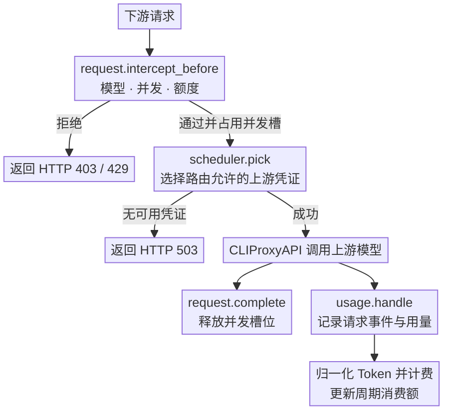
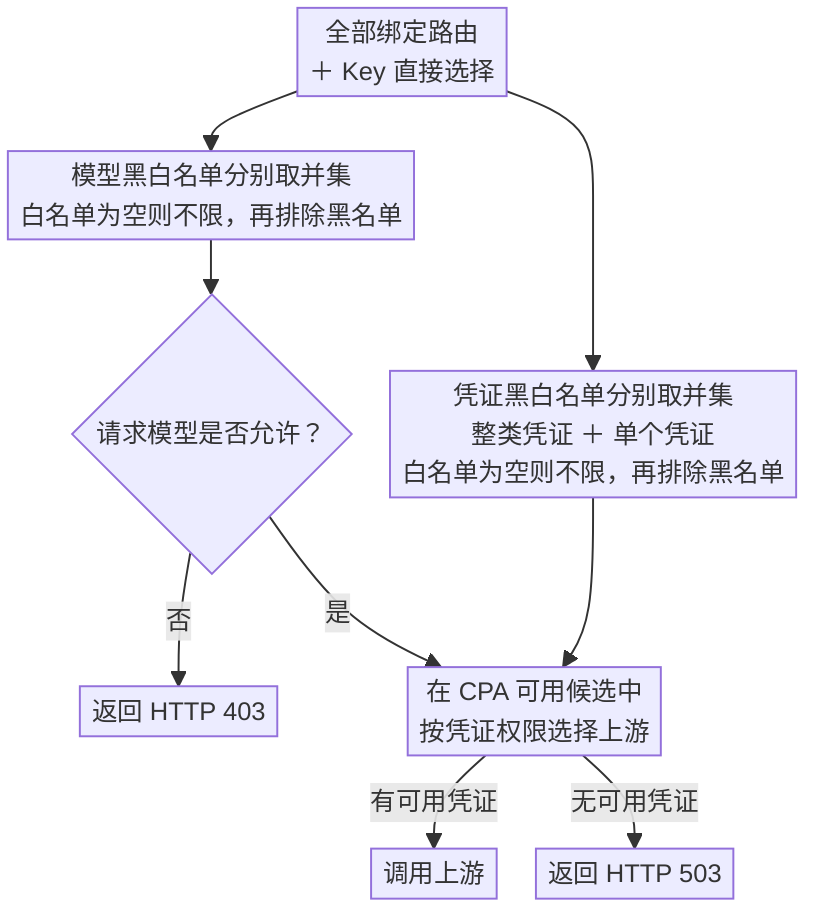

<div align="center">
  <h1>CPA Super Billing</h1>
  <p><strong>把 Claude 和 ChatGPT（Codex）订阅账号的额度分给多个下游 API Key 的 <a href="https://github.com/router-for-me/CLIProxyAPI">CLIProxyAPI</a> 插件。</strong></p>
  <p>
    <a href="https://github.com/sketchain/cpa-super-billing/releases/latest"></a>
    
    <a href="./LICENSE"></a>
  </p>
  <p><a href="./README.en.md">English</a> · <strong>简体中文</strong></p>
</div>

基于 [cpa-key-billing](https://github.com/haowang02/cpa-plugin-key-billing) 修改。原插件的计费、订阅额度、并发、路由功能全部保留，在此基础上新增「订阅分账」，支持 Claude 和 ChatGPT Team（经 CPA 的 Codex 渠道）订阅号。


## 功能特性

- **订阅分账（Claude / ChatGPT）**：固定 key 每周拿固定额度（例如 a 每周 $100），余量 key 只能用账号剩余的部分，并为固定 key 动态预留还没用掉的额度（周预留 + 5 小时预留）
- 只用响应头里被动拿到的用量百分比估算账号总额（折合美元），不主动查询上游；自动剔除在 CPA 之外直接使用账号带来的污染
- 消耗预测、加 key 模拟和每个 key 的用量图，帮助判断池子还能不能再卖
- 给 new-api「高级自定义渠道」提供余额接口
- 支持从 JSON 价格表批量导入自定义价格

- 支持金额、Token、请求三种额度，可按 API Key 独立计时或按订阅计划统一周期重置；「共享额度」计划让绑定的多个 Key 共同消耗一份额度，按计划时间统一重置
- 模型定价和订阅计划可分别使用美元或人民币计价，统计页面可按任一币种显示
- 支持按输入 Token 阈值切换长上下文**阶梯计价**
- 支持按 API Key 设置**最大并发请求数**
- 支持为每个 API Key 绑定**路由规则**，限制模型访问范围和上游凭证
- 可从 [models.dev](https://models.dev/) 获取模型参考价

## 工作原理

插件会在请求到达上游前检查订阅额度、并发和路由。上游调用结束后，CLIProxyAPI 通过 `usage.handle` 提供用量。插件据此记录请求事件、计算费用并更新周期消费额。



## 订阅分账

页面「订阅分账」顶部按订阅类型分 Claude / ChatGPT 两个页签，每个页签下是该类型的账号、池、key 分配、预测、趋势、模拟和模型倍率。管理接口仍在 `/cc/...` 下。

### 概念

- **账号**：CPA 里的一个 Claude 或 ChatGPT（Codex）OAuth 凭证（按 `auth_index` 区分），每个账号独立估算。
- **池**：一组同一订阅类型的账号（保存时校验，不能混放）。固定 key 和余量 key 都绑定到池；池的剩余 = 各账号剩余之和。每个池在页面上用「设为锚定」指定一个「锚定账号」，池内 key 的周期和 5h 窗口都跟着它走（旧数据升级后取原来的第一个账号）。一个账号只能属于一个池，保存时会检查。
- **固定 key**：在 API Key 页绑定一个含 **7 天金额窗口** 的订阅套餐（原插件的订阅计划），窗口金额就是它每周的额度。**每个固定 key 要绑定单独的套餐**：对齐周期时插件会修改套餐本身，绑了同一套餐的其他 key 也会跟着变。固定 key 不能绑「共享额度」套餐：共享套餐里每个 key 看到的都是整个池的额度和已用，按 key 预留会重复计算，保存 分账设置、把固定 key 绑到共享套餐或把它的套餐改成共享时都会被拒绝。
- **余量 key**：没有固定额度，只能用池扣掉固定 key 预留后剩下的部分；可选填一个自己的周上限。

### ChatGPT（Codex）订阅号

ChatGPT Team 订阅号经 CPA 的 Codex 渠道使用，分法和 Claude 一样（固定 key + 余量 key、周预留 + 5h 预留、余额接口），差别如下：

- **用量信号**：Codex 响应头 `X-Codex-Primary-*`（5h 窗口，300 分钟）和 `X-Codex-Secondary-*`（7d 窗口，10080 分钟）的 `Used-Percent`、`Window-Minutes`、`Reset-At`；WebSocket 请求由 CPA 把 `codex.rate_limits` 事件转成同名头。百分比可能带小数，切段以「跨过一个整数百分点」为界，一次跨多个点算一段。
- **切段窗口按账号自动判断**：账号的报告里有 5h 窗口就按 5h 切段，用 k 换算周总额；只有 7d 窗口时直接按 7d 切段，1% 就是周总额的 1%，不需要 k，也没有 5h 预留（页面标「仅 7d 窗口」）。之后出现 5h 窗口时，该账号的段从 5h 重新开始。
- **档位与 k**：只有 Team 档位，默认周总额 $60，**没有默认 k**。手动 k 优先，其次自动估算的 k；都没有时不硬算：5h 预留关闭、周预留照常（周总额用档位默认值或估算值），页面醒目提示「需要设置 k」。账号的 `X-Codex-Plan-Type` 为 `team` 时页面会建议档位。
- **只计主额度**：只有请求自己的报告里带主额度窗口时，这笔成本才计入切段；只带额外额度池（如 Spark）、Code Review、图像窗口，或 `X-Codex-Active-Limit` 不是 premium 的请求，以及没有报告的请求都不计入，页面「未计入估算的成本」列出合计。
- **用满与 credits**：报告显示窗口用满（`X-Codex-Limit-Reached` 或百分比到 100），或 credits 余额在下降时，暂停该账号的切段（沿用上一次估算，标「暂停」），恢复后自动继续，这段时间的花费不进入任何段。
- **未定价模型**：开启 `allow_unpriced_models` 时未定价请求记 0 元，这类请求不计入切段，页面列出模型名并提示去定价。
- **路由提示**：key 的路由规则没有把凭证限定在所在池的订阅类型内时，key 分配表标「路由未限定」（只提示，不拦截）。

参数区可以按订阅类型编辑档位表（周总额、默认 k），并覆盖大块间隔、滑动窗口宽度、k 所需 7d 涨幅、冷启动大块数和安全折扣（留空使用全局值）。模型额度倍率也按订阅类型分开。

### 估算方法

Anthropic 响应头 `anthropic-ratelimit-unified-5h-utilization` / `7d-utilization` 只给整数百分比，插件按账号这样估算：

1. **1% 段**：5h 用量每涨 1 格记一段，段的花费 = 这一格期间经过 CPA、走这个账号的所有请求花费之和（按插件现有计价）。响应头按请求开始时间记，花费按请求完成时间记；并发造成的乱序由「同一周期内用量只升不降」和 10 分钟乱序窗口处理（与上游 `quotaReorderHorizon` 一致）。每个大块第一次涨格之前的花费不计（对应的起点不足 1 格）。
2. **大块**：相邻数据间隔不超过 5 分钟的段属于同一大块；5h 窗口重置时强制断开。
3. **剔除污染**：在大块内用 8% 宽的窗口逐段滑动，窗口比值（涨幅% / 花费$）超出参照值 20% 就标为可疑；某段被覆盖它的窗口中有 ≥50% 可疑就剔除。参照值默认是全局历史加权平均，没有历史时退回本大块的迭代加权平均。外部用量只会让比值偏大，所以剔除只会让估算偏保守。不足一个窗口宽的大块整体和全局参照值比较。
4. **全局平均**：各大块的干净比值按 `(干净涨幅)^p` 加权；最近 14 天的大块占 90%，更早的占 10%。`T_5h = 100 / 全局比值`。
5. **k = 周总额 / 5h 总额**：相邻两次响应之间 5h 和 7d 的涨幅配对记录（任一窗口在两次之间重置就跳过这一对），按小时存档，保留期与段相同。和总额一样按时间加权：最近 14 天、更早的两组各自算 `k = Σ5h涨幅 / Σ7d涨幅`，某组的 7d 涨幅达到 10 个点才有效；两组都有效按 90% / 10% 合并，只有一组有效就用那一组，都不够但合计够就用合计比值，合计也不够就没有 k。可以手动覆盖。`T_week = k × T_5h`。
6. **冷启动**：干净大块少于 20 个时用档位默认周总额（Pro $250、Max 5x $1250、Max 20x $2500）。CPA 的 Claude 凭证文件里没有订阅档位，需要在页面上给每个账号手选（不选按 Pro 算）。冷启动时 `T_5h = 默认周总额 / k`。没有手动 k、k 也还没估算出来时，用档位默认 k（Pro / Max 5x / Max 20x 默认都是 8，可在参数区调整），k 来源显示为「档位默认」，5h 预留照常生效。

用合成数据（整数量化、并发乱序、零星和持续的外部用量、5h 重置）测试：干净数据下 T_5h 误差约 +0.3%，持续外部用量下约 −3%（偏保守），k 误差 < 1%。

### 放行规则

每个账号：

- `R_week = s × T_week × (1 − u_7d)`，`R_5h = s × T_5h × (1 − u_5h)`，`s` 是安全折扣（默认 0.9）

每个池：

- `P_week = Σ 固定 key max(0, 周额度 − 本周期已用)`
- 每个固定 key 的 5h 预留 = `max(0, min(周额度 / k − 本 5h 窗口已用, 本周剩余))`，`1/k` 这个比例可以按 key 手动覆盖
- 余量 key 只在 `Σ R_week > P_week`，并且（5h 预留启用时）`Σ R_5h > Σ 5h 预留` 时放行
- 被拦时返回原插件同样的 `429 rate_limit_error`，提示文字写明是被「weekly reservation」（周预留）、「5-hour reservation」（5h 预留）还是 key 自己的「weekly cap」拦下的，`Retry-After` 指向对应窗口的重置时间
- 每次拦截按（key、原因、窗口重置时间）去重后写一条插件日志，内容包括 key、原因（`weekly_reserve` / `five_hour_reserve` / `weekly_cap` / `pool_unavailable` / `not_loaded`）和当时的估算数值

固定 key 自身只受它的订阅套餐限制，不会被池拦下。

放行这一步只读内存里的估算快照：不在任何池里的 key 直接放行，不碰估算逻辑；池里的 key 用快照里的总额、响应头即时更新的用量百分比、以及用量回调里实时累加的花费来算，不查数据库，也不会被估算刷新卡住。估算刷新在插件启动、每次用量回调（请求结束后，最多每分钟一次，正在刷新时直接跳过）和管理页按钮里同步执行，插件不开后台线程。分账设置已加载但估算快照还没生成时，余量 key 返回 429（原因 `not_loaded`），固定 key 和不在池里的 key 照常放行；这个行为可以用参数区的「估算未加载时拒绝余量 key」关掉（默认开），订阅分账页会显示「估算未加载」。连设置都没加载上时所有请求照常放行（日志记一条）。余额接口在估算加载前返回 503。固定 key 的周期对齐结果有缓存，缓存失效（首次、套餐改动、等待结束）时这一步会写一次库修改套餐锚点。

### 固定 key 的周期

- 插件会把固定 key 所绑套餐的 7 天窗口自动改成「统一周期」（所以每个固定 key 要用单独的套餐；共用同一套餐的固定 key 分在不同池时保存会被拒绝），起点对齐锚定账号的 7d `reset_at`。滚动周期的套餐如果还有其他窗口，无法自动对齐（页面会提示）。
- Anthropic 提前重置时（沿用上游 `QuotaWindowPeriods` 的提前重置检测）：当前周期不重置、已用额度不清零，跑到原定结束时间；下一个周期再对齐到账号新的 `reset_at`。
- 没用完的额度到期作废，不转给余量 key。5h 预留跟随锚定账号的 5h 窗口。

### 配置项

全部在管理页面「订阅分账」里调整，保存在数据库里（不在 YAML 中）：

| 参数 | 默认值 | 说明 |
| --- | --- | --- |
| 段保留天数 | 365 | 与 `request_event_retention_days` 互不影响 |
| 大块间隔 | 5 分钟 | 修改后只影响新数据；需要作用于历史时点「从历史重建」 |
| 滑动窗口宽度 | 8% | |
| 参照值 | 全局历史 | 或「本大块迭代平均」 |
| 可疑阈值 | 20% | |
| 剔除票数比例 | 50% | |
| 权重指数 p | 2 | |
| 近期天数 / 近期占比 | 14 天 / 90% | |
| k 所需 7d 涨幅 | 10 点 | |
| 冷启动大块数 | 20 | |
| 档位默认周总额 | Claude：Pro $250 / Max 5x $1250 / Max 20x $2500；ChatGPT：Team $60 | 按订阅类型 |
| 档位默认 k | Claude 都是 8；ChatGPT 未设置 | 账号没有手动 k、也没估算出 k 时使用 |
| 按订阅类型覆盖的参数 | 留空 | 大块间隔、滑动窗口宽度、k 所需 7d 涨幅、冷启动大块数、安全折扣 |
| 估算未加载时拒绝余量 key | 开 | |
| 安全折扣 s | 90% | |
| 账号档位、手动 k | 未设置 / 自动 | 按账号 |
| 池的账号、锚定账号 | — | 按池 |
| key 类型、池、5h 预留比例、余量 key 周上限 | — | 按 key |

### 额度趋势

「订阅分账」页为每个池内账号画两张按天的图，按浏览器本地时区切分日期：

- 每日 k：当日 k = 当日 Σ5h 涨幅 / Σ周涨幅（周涨幅为 0 的天没有 k），滚动 7 天 k（开头不足 7 天时用已有天数），以及当前生效 k 的参考线（标注自动 / 手动 / 档位默认）。当日周涨幅低于参数「k 所需 7d 涨幅」（`k_min_weekly_points`）的天画成空心点，表示精度不够。
- 每日涨幅与推算周总额：当日 Σ5h、Σ周涨幅的柱状图，右轴是推算周总额 = k × $/1% × 100。$/1% 是当日段的花费 / 涨幅，只用估算保留的段；估算未加载时拿不到剔除结果，按全部原始段计算。当日 k 缺失或精度不足时改用滚动 k（菱形点）。

悬停显示当天的两个涨幅、段数、花费、当日 k、滚动 k、$/1% 和推算周总额；可切换 7 / 14 / 30 天或全部保留期。数据只读取已存的每小时 k 证据和 1% 段，打开图表不会触发估算刷新，也不写库；API Key 用户的视图里没有这部分。

### 模型额度倍率

个别模型每美元消耗的订阅额度可能和 API 价格不成比例。在「订阅分账」页把这类模型标为**待测项**（同一模型的多个名字可以归成一项），其他模型都算基准，倍率固定为 1。

- **按模型拆分**：每个 1% 段同时记下段内各计费模型的花费。升级前的段没有拆分，按基准处理；「从历史重建」会根据保留的请求记录重建所有段并补上拆分（超出请求记录保留期的段无法补）。
- **历史估计**：每段涨幅 ≈ s ×（基准花费 + Σ mᵢ × 待测项 i 的花费），每个账号有自己的 s，倍率 mᵢ 各账号共用。段按约 30 分钟切块（只在涨格处断开，按时间而不是按涨幅断开，避免取整误差进入花费导致倍率偏向 1），用加权最小二乘拟合，时间加权与总额相同（近 14 天占 90%），输出倍率、标准误、95% 区间、参与段数和占比范围。
- **避免剔除循环**：剔除依赖 $/1%，原口径下待测模型用得多的段会被当成外部用量剔掉。倍率估计不论开关如何，都在换算口径上剔除：先对全部段做一次修剪向上离群块的稳健拟合得到初值，再交替「按当前倍率换算后剔除 → 用干净块重新拟合」直到收敛；含被剔除段的块整块丢弃，不在剔除处截断。
- **不给数字的情况**：包含该项的干净段数或花费低于阈值（默认 30 段、$20）标「样本不足」；该项占比在各块间的标准差低于阈值（默认 5%）或方差膨胀过大标「占比变化不足，建议校准」；标准误超过倍率一半标「估计不稳定」。
- **校准**：选待测项和账号，点「开始校准」到「结束校准」。期间只含该项的段直接算 $/1%，和同期只含基准模型的段比较（不足 10 段时加上校准前近期的基准段），混入其他模型的段不计入并显示数量。结束且该时段处理完后结果存库，可以查看和删除。
- **接入估算**：开关「估算使用模型倍率」默认关闭，关闭时估算与之前完全一致。打开后每段花费先换算成基准口径（基准花费 + Σ mᵢ × Cᵢ）再剔除和加权，$/1% 表示基准模型的美元 / 1%。倍率来源：手动覆盖 > 最近的校准结果 > 历史估计，都没有时按 1 处理并在页面标明。页面同时列出两种口径下的 $/1%、周总额和剔除段数。
- **计费建议**：每个待测项显示建议价格倍率（额度倍率 × 当前价格倍率，因为段花费按当前价格记录）和价格表中自定义价相对官方价的倍率，只做展示，不修改价格表。

倍率在刷新时计算并放进快照，放行只读快照。`GET /cc/estimates` 返回当前生效口径下各账号的估算和倍率。

### 消耗预测

「订阅分账」页账号表下方按池列出：每个池、每个账号的 5h 用量和 7d 用量预计什么时候到 100%，以及余量 key 什么时候会被周预留或 5h 预留拦住（池剩余 R − 预留 P 降到 0 的时间）。

- **速度**：默认 5h 看最近 1 小时、周看最近 24 小时，页面上可调（5–300 分钟 / 1–168 小时，只记在当前浏览器）。以账号利用率读数的涨幅为主（窗口在时段内重置时从 0% 算起，只用当前窗口的读数），同时显示池内 key 的实时花费按估算 $/1% 换算出的速度；账号没有读数时改用花费速度。
- **口径**：估算开启「估算使用模型倍率」时，容量是基准美元，key 花费按记账价格计算，先按生效倍率折成基准口径再换算；价格表倍率已经等于该模型额度倍率的不重复折算。悬停提示写明用的是哪种口径。
- **余量 key 拦截**：R 按读数（或花费 × 安全折扣 s）下降，P 按仍有预留的固定 key 的花费下降，预测 (R − P) ÷ (R 的下降速度 − P 的下降速度)。
- 线性外推的时间晚于窗口重置时间时显示「重置前用不完」。悬停单元格可以看到两种速度、依据的时间段和算法。估算结果统一从 Manager 的取值接口和快照读取，打开预测不触发估算刷新，也不写库。

### 加 key 模拟

选一个池，假设新增固定 key（周额度、可选 5h 比例、每周用量，默认用满），或修改、移除已有固定 key 的额度，用保留期内（最多 365 天）的请求记录按小时回放：

- 池内各 key 每小时的花费来自请求记录，开了模型倍率时按倍率换算成额度口径；池剩余由各账号每小时最后一次利用率读数推算（外部用量照实计入），再加减假设带来的用量；账号周总额、5h 总额和 k 用当前估算。
- 周期边界用锚定账号历史读数里的 7d reset（提前重置会截短周期），拿不到的部分按当前 reset 每 7 天往回推。
- 输出每个周期余量 key 被拦的小时数（区分周预留 / 5h 预留）、预计少放行的金额（被拦小时内余量 key 实际记录的花费）、固定 key 预留超过池剩余（超卖）的小时数、最大缺口和超卖时段，并和不做修改的回放并排对比。
- 结果是近似值，页面列出近似在哪里：总额用当前估算、外部用量按读数推算、按小时步进、新 key 按池内原有花费的小时分布摊开、首个周期不完整等。模拟只读：不写库，也不改设置。

### Key 用量

每个池一张按天的图：池内每个 key 当日的花费（堆叠柱，按记账价格），余量 key 叠加当日被 分账拦截的次数（虚线，右轴，悬停显示原因分布）。固定 key 另有一张按套餐周期的图：每期用掉多少、作废多少（周额度 − 本期已用，周期结束时结算；进行中的周期显示剩余，不算作废）。按浏览器本地时区切分日期，范围可切换 7 / 14 / 30 天或全部。

拦截次数按（key, 小时, 原因）计数存进 `cc_block_counts` 表（CC 表结构版本升到 4）。拦截发生在请求路径上，只在内存里累加，随后续的估算刷新或打开用量图时一次写库；插件日志仍按原规则去重，每个 key、原因和窗口只记一条。

`GET /cc/forecast`、`POST /cc/simulate`、`GET /cc/key-usage` 只对管理端开放。

### 认证文件页

加入 分账池的 Claude 账号，在认证文件页打开「额度预估」后，以及在详情抽屉里，显示 订阅分账的结果：5h 总额、周总额、k（自动/手动/档位默认）、R 周 / R 5h 和冷启动状态，取代按「已用量 × 100 / 已用百分比」推算的预估额度。数据取自最近一次估算快照，打开页面不会触发估算刷新。其他账号保持原样。

### 给 new-api 用的余额接口

```text
GET /v0/resource/plugins/cpa-super-billing/balance
Authorization: Bearer <下游 API Key>
```

返回 `{"object":"credit_summary","total_available": <美元>}`，只按周计算：固定 key = 周额度 − 本周期已用；余量 key = `Σ R_week − P_week`（填了周上限时再和「上限 − 已用」取小）。结果 ≤ 0 时一律返回 `1`：这是有意设计，防止 new-api 在余额 ≤ 0 时自动禁用渠道；实际余额请看「订阅分账」页（页面同时显示上报值）。余量 key 的余额是整个池共享的：同一池的多个余量 key 各自返回同一笔池余额，不能相加。没有加入池的 key 返回 404，无效 key 返回 401。

new-api 配置（渠道类型选「高级自定义」）：

1. 渠道的 Base URL 填 CPA 地址，例如 `https://cpa.example.com`，密钥填下游 API Key。
2. 在高级路由（`advanced_routes`）里加一条余额路由：`incoming_path` 为 `/v1/dashboard/billing/credit_grants`（new-api 固定使用这个路径查询余额），`upstream_path` 为 `/v0/resource/plugins/cpa-super-billing/balance`，转换器选「无」，鉴权保持默认（`Authorization: Bearer <渠道密钥>`）。

   ```json
   {
     "advanced_routes": [
       { "incoming_path": "/v1/dashboard/billing/credit_grants", "upstream_path": "/v0/resource/plugins/cpa-super-billing/balance", "converter": "none" }
     ]
   }
   ```

3. 在渠道列表点「更新余额」即可。new-api 读到 `object = credit_summary` 且 `total_available` 为数字时直接显示为余额。

### 导入价格表

设置页「模型定价」卡片点「导入 JSON」。文件可以是数组，也可以是 `{"models": [...]}`，每项字段为 `name`、`aliases`、`input`、`output`、`cache_read`、`cache_write`（每百万 token 美元价），`name` 和每个别名都会写成一条自定义价，其他字段（例如阶梯价备注）忽略。也可以直接调用 `POST /v0/management/plugins/cpa-super-billing/prices/import`。

## 从 cpa-cc-billing 迁移

插件从 v0.3.0 起改名为 `cpa-super-billing`。CLIProxyAPI 按动态库文件名识别插件，改名等于安装一个新插件，配置、商店地址和余额路径都要手动改一次；数据库会自动沿用。

1. 停止 CLIProxyAPI（Docker Compose 部署停止 `cli-proxy-api` 服务）。
2. 备份 `plugins/cpa-cc-billing-state-v1.db`，连同同名的 `-wal`、`-shm` 文件（存在时）。
3. 删除 `plugins` 目录（含按平台划分的子目录）里所有 `cpa-cc-billing*.so`（Windows 为 `.dll`，macOS 为 `.dylib`），再放入新插件 `cpa-super-billing*.so`。
4. 在 `config.yaml` 里把 `plugins.configs.cpa-cc-billing` 整段改名为 `plugins.configs.cpa-super-billing`，段内的设置（包括 `store.version`、`store.release-tag` 版本锁）原样保留；如果锁了版本，改成新插件的版本号。
5. 如果 `plugins.store-sources` 里引用了旧仓库的 `registry.json`，改成 `https://raw.githubusercontent.com/sketchain/cpa-super-billing/main/registry.json`。
6. new-api 渠道的余额路由：把 `upstream_path` 从 `/v0/resource/plugins/cpa-cc-billing/balance` 改成 `/v0/resource/plugins/cpa-super-billing/balance`。管理页地址也变为 `/v0/resource/plugins/cpa-super-billing/ui`。
7. 启动 CLIProxyAPI。

> [!WARNING]
> 新旧两个动态库不能同时留在 `plugins` 目录里。CLIProxyAPI 会把它们当成两个插件同时加载，请求会被拦截两次、用量记两次账。

数据库：没有显式配置 `state_file` 时，新插件默认使用 `plugins/cpa-super-billing-state-v1.db`。如果这个文件还不存在、而旧的 `plugins/cpa-cc-billing-state-v1.db` 存在，插件启动时会像迁移前自动备份一样用 SQLite 的 `VACUUM INTO` 把旧库完整复制成新文件，校验通过后打开新文件，并在插件日志和「订阅分账」页提示。旧库保留不动，确认数据无误后可以手动删除（连同 `-wal`、`-shm`），删除后提示消失。复制失败时插件不会启动，日志写明原因；也可以把 `state_file` 显式指向旧文件继续使用。显式配置了 `state_file` 时，插件按配置打开，不做复制。

浏览器里保存的登录凭证、主题、语言和视图偏好会在新页面首次打开时自动从旧名下复制过来。

## 从 cpa-key-billing 迁移

1. 停止 CLIProxyAPI，备份 `plugins/cpa-key-billing-state-v1.db`（连同同名的 `-wal`、`-shm` 文件，如果存在）。
2. 复制为新文件名：

   ```sh
   cp plugins/cpa-key-billing-state-v1.db plugins/cpa-super-billing-state-v1.db
   # 如果存在 -wal / -shm，也一起复制并改成同样的前缀
   ```

3. 移除旧插件的动态库和 `plugins.configs.cpa-key-billing` 配置（两个插件同时启用会重复拦截和记账），安装本插件并加上 `plugins.configs.cpa-super-billing`。
4. 启动 CLIProxyAPI。原有的 Key、套餐、路由、价格和历史请求全部保留；订阅分账用的新表（`cc_meta`、`cc_segments`、`cc_streams`、`cc_k_buckets`）会自动创建。原表结构版本不变，所以这个文件仍然可以被原插件打开。
5. 打开「订阅分账」页，给账号选档位、建池、分配 key。插件会用保留期内的历史请求自动生成 1% 段，迁移后马上就有估算数据。

## 环境要求

- CLIProxyAPI `7.3.7` 或更高版本，支持 v8，建议使用最新版本；[按路由规则过滤模型列表](#模型列表)需要 `8.0.37` 或更高版本
- 使用支持插件的 CLIProxyAPI 构建，不要使用 no-plugin 版本

## 安装

### 商店安装

CPA 管理面板（CPAMC 或 CPAMP）插件商店搜索 `cpa-super-billing`。

### 人工安装

在 CLIProxyAPI 根目录运行。macOS 和 Linux 使用：

```sh
curl -LsSf https://raw.githubusercontent.com/sketchain/cpa-super-billing/main/install.sh | sh
```

Windows 请先停止 CLIProxyAPI，再在 PowerShell 中运行：

```powershell
irm https://raw.githubusercontent.com/sketchain/cpa-super-billing/main/install.ps1 | iex
```

安装脚本会将插件安装到当前目录的 `plugins/`。安装或升级完成后需要重启 CLIProxyAPI。

在 CLIProxyAPI 配置文件中加入：

```yaml
plugins:
  enabled: true
  dir: "plugins"
  configs:
    cpa-super-billing:
      enabled: true
      priority: 100 # 插件调度优先级，数值越大越优先
      debug: false # 是否记录 debug 日志，例如路由日志、匹配参考价日志
      codex_fast_mode_billing: false # 开启后，Codex 的 priority 请求按 2.5 倍计费
      allow_unpriced_models: false # 放行未定价模型的请求，用量按 0 费用记录
      cny_per_usd: 7 # 汇率：1 美元兑换的人民币数，用于换算不同币种的金额
      mask_api_key_view_emails: false # 对 API Key 查询页面返回的邮箱进行掩码脱敏
      allow_api_key_quota_reset: false # 允许 API Key 用户重置可访问的 Codex 和 Claude 认证文件额度，消耗上游重置次数
      request_event_retention_days: 365 # 请求事件及关联错误事件的保留天数，正整数
      state_file: "plugins/cpa-super-billing-state-v1.db"
      routing:
        strategy: "round-robin" # round-robin、weighted-round-robin、fill-first
        session-affinity: false # 同一会话优先复用可用的上游凭证
        session-affinity-ttl: "1h" # 会话绑定的空闲过期时间
```

路由规则对上游凭证设有限制时，插件按上述 `routing` 配置调度；其他请求由 CPA 调度。插件配置与 CPA 的全局调度配置相互独立。

CPA 按插件优先级选择调度插件，不会依次调用。建议显式设置 `priority: 100`，使本插件优先参与调度；省略时使用 CPA 的默认值 `0`。无论由谁调度，所选凭证都必须符合 API Key 的路由规则；凭证不符合规则或无法完成校验时，请求返回 `503`，原因记录在插件日志中。

首次调度或会话绑定失效时，插件按配置的策略，从优先级最高的可用凭证中选择。启用会话粘性后，同一会话优先复用已绑定的凭证；凭证不可用或会话空闲时间超过 `session-affinity-ttl` 后，重新选择凭证。会话标识由 CPA 提供，没有会话标识的请求按常规策略调度。

> [!WARNING]
> 升级前请停止服务并备份数据文件，见[升级与数据库恢复](#升级与数据库恢复)。
>
> - 可以直接使用 cpa-key-billing v1.0.0 及以后版本的数据库文件，见[从 cpa-key-billing 迁移](#从-cpa-key-billing-迁移)。
> - cpa-key-billing v0.8.4 及更早版本的 JSON 或 SQLite 数据文件不支持迁移，请将 `state_file` 指向新文件。

重启 CLIProxyAPI 后，在管理中心打开「CPA Super Billing」。确认模型定价后，创建订阅计划并绑定需要限制的 API Key。

## 升级与数据库恢复

### 升级前

1. 停止 CLIProxyAPI（Docker Compose 部署停止 `cli-proxy-api` 服务）。
2. 备份 `state_file` 指向的数据库（默认 `plugins/cpa-super-billing-state-v1.db`），连同同名的 `-wal`、`-shm` 文件（存在时）。这三个文件要在停止服务后一起复制，只复制 `.db` 可能丢失还没写回主文件的最新数据。
3. 替换插件，启动 CLIProxyAPI。

回退到旧版插件前，要先恢复升级前的备份：新版迁移过的数据库，旧版无法打开。

### 迁移前自动备份

插件打开数据库时，如果需要升级表结构（计费表的 `PRAGMA user_version`，或 CC 表 `cc_meta` 的 `schema_version`），会先用 SQLite 的 `VACUUM INTO` 把整个数据库（包括 WAL 中的内容）备份到同一目录，确认备份能打开、完整后再迁移：

```text
plugins/cpa-super-billing-state-v1.db.bak-u24-to-u25-cc4-20261107T120000
```

文件名依次是计费表的旧、新版本，CC 表的旧、新版本（没有变化时只写一个），以及备份时间（UTC）。备份文件权限为 `600`，只保留最近 3 份，更早的自动删除；不需要迁移时不备份。备份成功后，插件日志会记录备份路径。

备份失败时（例如目录不可写、磁盘空间不足）不会迁移：插件注册失败，CLIProxyAPI 日志写明原因和数据库路径，处理后重启即可。迁移本身失败时，日志会给出这次的备份路径。

### 运行中查看数据库

CLIProxyAPI 运行时，只能用只读方式查看活库：

```sh
sqlite3 -readonly plugins/cpa-super-billing-state-v1.db "SELECT count(*) FROM request_events"
sqlite3 'file:plugins/cpa-super-billing-state-v1.db?mode=ro' "SELECT count(*) FROM request_events"
```

运行中不要对活库写入，不要执行 `.recover` 或把 `.backup` 写回原库，也不要用其他程序复制、改名或删除 `.db`、`-wal`、`-shm`。v0.3.0 及更早的插件会丢失自己在数据库上的文件锁（见 Changelog 的 v0.3.1）：插件运行中，只要有人用 SQLite 3.51 以下的 sqlite3（如 Debian 13 自带的 3.46.1）以普通方式查询一次活库，`-wal`、`-shm` 就会被删除，之后的写入只进入已删除的文件。

自查是否处于这种状态（Docker 部署在容器内执行，CLIProxyAPI 通常是 PID 1）：

```sh
docker compose exec cli-proxy-api ls -l /proc/1/fd | grep deleted
# 非 Docker 部署：ls -l /proc/<CLIProxyAPI 的 PID>/fd | grep deleted
```

输出里出现 `…-state-v1.db-wal (deleted)` 或 `…-state-v1.db-shm (deleted)` 即是。v0.3.1 起插件每分钟最多自检一次（在请求计费和打开管理页时），发现后写一条错误日志、在管理页顶部和「订阅分账」页告警，并持续把已删除 WAL 里的数据 checkpoint 回主库。处于这种状态时：

- 只能优雅停止 CLIProxyAPI（`docker compose stop`，或正常停止服务），让插件关库时把数据写回主库，然后再启动；不要 `docker kill`、`kill -9`，也不要缩短停止超时，强杀会丢失已删除 WAL 里的数据。
- 停止之前，不要启动另一个使用同一数据库的 CLIProxyAPI，也不要对这个库写入：两份 WAL 同时写同一个库会损坏表结构（如 `invalid rootpage`）。

### 数据库损坏时

插件注册失败、日志出现 `malformed database schema`、`database disk image is malformed` 或 `file is not a database` 时，数据库文件已经损坏。日志会同时列出同目录下可用的迁移备份。

1. 停止 CLIProxyAPI，把损坏的 `.db`、`-wal`、`-shm` 文件另存一份。
2. 有合适的备份时直接恢复：把迁移备份（或自己的备份）复制为 `state_file`，删除原来的 `-wal`、`-shm`，启动后插件会重新迁移。备份之后记录的数据会丢失。
3. 没有合适的备份时，用 sqlite3 抢救损坏的文件，再用恢复出的文件替换原文件（同样删除原来的 `-wal`、`-shm`）：

   ```sh
   sqlite3 plugins/cpa-super-billing-state-v1.db ".recover" | sqlite3 plugins/cpa-super-billing-state-v1.db.recovered
   ```

4. 启动后打开「订阅分账」页，点「从历史重建」，补回 `cc_segments` 等由请求历史推导出的数据。

## 页面访问

管理员可以从 CLIProxyAPI 管理中心的「CPA Super Billing」菜单进入，也可以直接打开：

```text
http(s)://<CLIProxyAPI 地址>/v0/resource/plugins/cpa-super-billing/ui
```

普通用户使用自己的 API Key 查询订阅额度和用量时，直接打开：

```text
http(s)://<CLIProxyAPI 地址>/v0/resource/plugins/cpa-super-billing/ui#account
```

设置页的「页面显示」卡片保存在数据库里，升级后自动带上默认值：

- 勾选的标签页不在导航中显示（「设置」不能隐藏），默认隐藏「AI 供应商」。只影响显示，对应的管理接口照常工作。
- 「允许 API Key 用户自助查询」默认开启。关闭后登录页不再显示 API Key 入口，自助页用到的资源路由一律返回 404；`/balance` 余额接口不受影响。

## 计费与订阅规则

- 未绑定订阅计划的 API Key 只统计用量，不限制额度。
- 订阅计划可设置多个自定义额度窗口，每个窗口可单独或组合限制金额、Token、请求数。
- 每个 API Key 独立记账。独立周期从首次放行开始；统一周期可为各窗口指定下次开始时间，所有绑定 Key 按固定时间重置。
- 手动重置额度时，统一周期的重置时间保持不变；独立周期在下一次放行时重新开始。
- 自定义价优先于 models.dev 参考价。没有任何可用价格时拒绝新请求；开启 `allow_unpriced_models` 后放行，用量照常记录，费用为 0，其他额度和路由限制不变。
- 自定义价和订阅计划各自选择美元或人民币，内置价和参考价为美元。每笔请求按所用价格的币种记账；订阅额度按计划币种扣减，其他币种的消费按 `cny_per_usd` 换算。修改汇率或计划币种不会改写已记录的金额，额度用量按当前汇率重新换算。
- 分析、请求事件、认证文件和 AI 供应商页面可选择显示币种。默认的“自适应”使每项统计保留其消费的币种，混合多种币种时按美元显示。
- 请求事件及关联错误事件默认保留最近 365 天，可通过 `request_event_retention_days` 配置（1–106751 天）；缩短期限会清除超期历史。请求事件页面支持清理全部数据或指定天数以前的数据；清理会影响历史统计，不会重置订阅额度已用量。

## 路由规则

在 API Key 页面绑定路由规则，也可直接选择模型、整类凭证或单个凭证。点击模型或凭证的选框，可在未选择、白名单（勾号）、黑名单（叉号）之间切换。整类凭证包含该类别后续新增的凭证，也可用黑名单排除其中的单个凭证。模型与凭证分别合并所有绑定规则和直接选择：白名单取并集，黑名单取并集，黑名单优先。白名单为空时允许全部，再排除黑名单。



### 模型列表

使用 CLIProxyAPI `8.0.37` 或更高版本时，API Key 获取的模型列表只包含路由规则允许、且有允许的凭证提供的模型，客户端不会再显示无法调用的模型。旧版本 CLIProxyAPI 仍返回完整的模型列表。

## 拦截请求的响应

| 场景 | 状态码 | `type` | `code` |
| --- | --- | --- | --- |
| API Key 并发已满 | `429` | `rate_limit_error` | `rate_limit_exceeded` |
| 订阅额度用尽 | `429` | `rate_limit_error` | `rate_limit_exceeded` |
| 余量 key 被分账周预留 / 5h 预留 / 自身周上限拦下 | `429` | `rate_limit_error` | `rate_limit_exceeded` |
| 模型无权访问 | `403` | `permission_error` | `insufficient_quota` |
| 路由规则允许的凭证都不提供该模型，或当前都不可用 | `503` | `server_error` | `internal_server_error` |
| 选中的凭证不符合路由规则 | `503` | `server_error` | `routing_credential_mismatch` |
| 无法校验所选凭证的路由权限 | `503` | `server_error` | `routing_credential_unverified` |
| 模型未定价且未开启 `allow_unpriced_models` | `503` | `cpa_super_billing_error` | `model_price_error` |

## 致谢

- [LINUX DO](https://linux.do/) - 新的理想型社区
